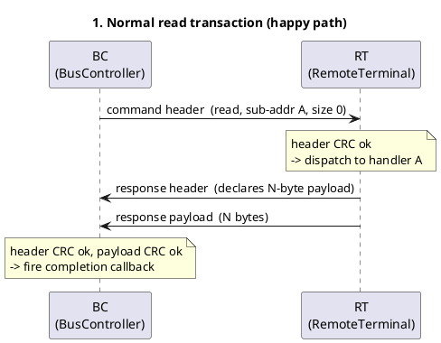
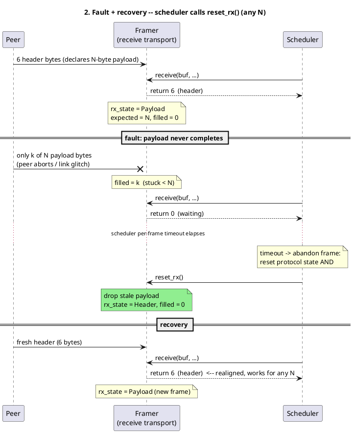
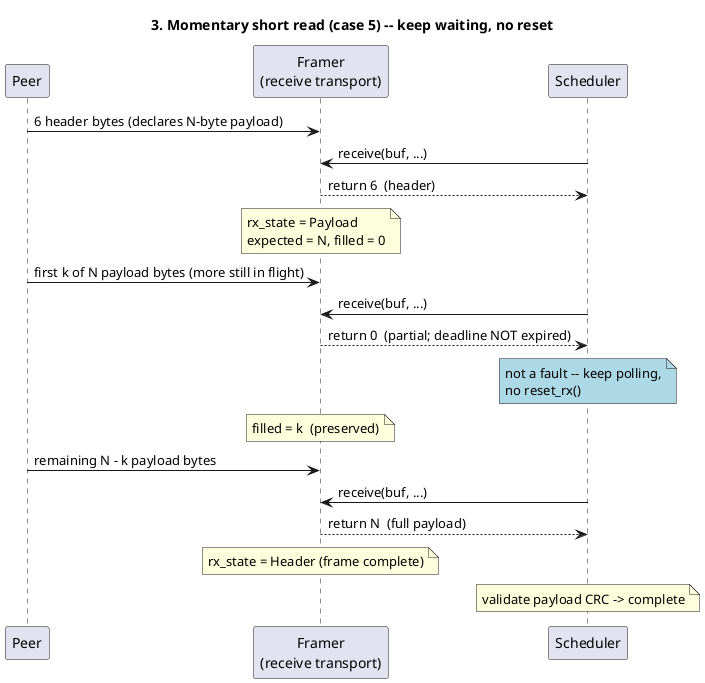

# Frame transport: traffic flow, faults, and recovery

These sequence diagrams illustrate how the Protocol T2 byte-stream framing
transports (`SerialFrameTransport`, `UartFrameTransport`, `UsbCdcFrameTransport`
— identical framing logic) reassemble frames, and how a partially-received
payload is recovered.

## How recovery works

Each receive framer is a two-state machine: `Header` (collect 6 bytes, validate the header
CRC, with a sliding-window resync on a bad CRC) → `Payload` (collect the declared `N` bytes,
then return to `Header`). State persists across `receive()` calls. A header declaring size 0
or size 2 (whose 2-byte payload is inline in the header) has no payload chunk, so the framer
stays in `Header`.

The transport has **no timeout of its own**. The `BusController` / `RemoteTerminal` owns the
per-frame deadline, and when it abandons a frame (timeout, transport error, CRC failure, or an
inbound fault) it calls **`reset_rx()`**, which drops any in-progress payload and returns the
framer to hunting for a header. This keeps transport framing in lock-step with protocol state
**regardless of payload size**. Crucially, `reset_rx()` is invoked *only* on a genuine abort —
a momentary short read (data simply hasn't all arrived yet) is left alone so its partial
progress is preserved.

In the zoom-in diagrams: **Peer** is the far end emitting bytes, **Framer** is the receiving
transport, and **Scheduler** is the `BusController`/`RemoteTerminal` driving `receive()` and
`reset_rx()` from its `tick()` loop.

---

## 1. Normal read transaction (protocol level)

---

## 2. Fault + recovery via `reset_rx()` (any payload size)

A header is received and the framer enters `Payload`, but the payload never completes. The
scheduler times out, abandons the frame, and calls `reset_rx()`. This recovers identically
whether `N` is large or small — there is no longer any size-dependent behavior.

This single mechanism covers every fault case:

| # | Fault case | Recovery |
|---|------------|----------|
| 1 | Payload **larger** than a header, not all bytes received | timeout → `reset_rx()` clears the stuck payload |
| 2 | Large payload, all bytes received but CRC mismatches | full chunk already consumed (framer aligned); scheduler aborts on the CRC check and calls `reset_rx()` as a harmless no-op |
| 3 | Payload **smaller** than a header, not all bytes received | identical to #1 — timeout → `reset_rx()` (this is the case the old buffer-size heuristic could not detect) |
| 4 | Small payload, all bytes received but CRC fails | identical to #2 — aligned; `reset_rx()` no-op |

---

## 3. Momentary short read — no reset (normal partial)

When data simply hasn't fully arrived yet and the deadline has **not** expired, the scheduler
keeps waiting. It does **not** call `reset_rx()`, so the framer's partial progress is preserved
and the frame completes once the remaining bytes land.

---

## Notes

- Recovery is **scheduler-driven and uniform across payload sizes** — there is no buffer-size
  heuristic in `receive()`. The transport only frames; the scheduler decides when a frame is
  abandoned and calls `reset_rx()`.
- `reset_rx()` resets the framer state only; it does not flush the underlying byte source. Any
  residual stale bytes still queued are realigned by the header sliding-window CRC resync inside
  `receive()`.
- The `LoggingFrameTransport` decorator forwards `reset_rx()` to the wrapped transport and
  resets its own RX logging state so the BC host log stays aligned after an abort.
